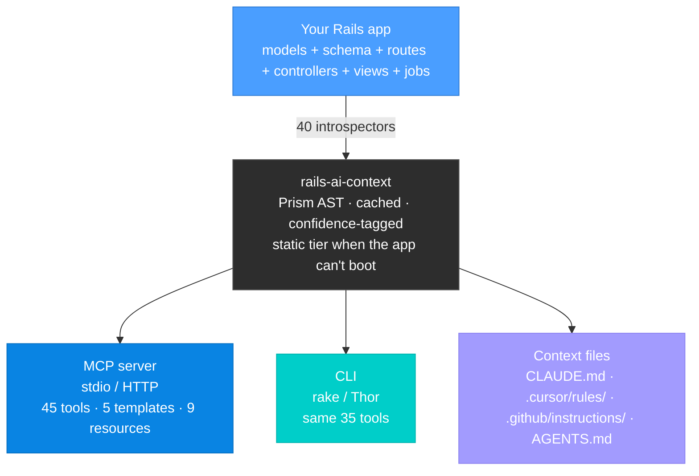

<div align="center">

# rails-ai-context

### Your AI coding assistant, reading your real Rails app instead of guessing it.

[](https://rubygems.org/gems/rails-ai-context)
[](https://rubygems.org/gems/rails-ai-context)
[](https://github.com/crisnahine/rails-ai-context/actions/workflows/ci.yml)
[](https://registry.modelcontextprotocol.io)
[](docs/COMPATIBILITY.md)
[](docs/COMPATIBILITY.md)
[](LICENSE)

[](docs/SETUP.md#claude-code)
[](docs/SETUP.md#cursor)
[](docs/SETUP.md#github-copilot)
[](docs/SETUP.md#opencode)
[](docs/SETUP.md#codex-cli)
[](docs/CLI.md)

**[Install in one paste](#install-in-one-paste)** · [Why](#why) · [What you get](#what-you-get) · [Tools](#tools) · [Commands](#commands) · [Docs](#documentation)


</div>

**rails-ai-context** makes your Rails app the source of truth for your AI coding assistant. The assistant stops guessing your schema, associations, routes and conventions from training data and asks your app instead: **35 read-only tools** over [MCP](https://modelcontextprotocol.io) or the command line, plus context files written for Claude Code, Cursor, GitHub Copilot, OpenCode and Codex CLI.

## Install in one paste

Open your AI tool at the root of your Rails app and paste this. It installs the gem, sets up the AI tool you're in, checks the result and tells you the one step left.

<!-- BEGIN install-prompt: kept identical to "Install (recommended)" in docs/PROMPTS.md by spec -->
```text
Install the rails-ai-context gem in this Rails app so you can read its schema, models, routes and code through its tools instead of guessing.

1. Run `ruby -v` and `bundle exec rails -v`. rails-ai-context needs Ruby 3.1+ and Rails 7.0+. If either is older, stop and tell me.
2. Pick TOOL, the key for the AI tool you are: claude (Claude Code), cursor (Cursor), copilot (GitHub Copilot in VS Code), opencode (OpenCode), codex (Codex CLI). If you are another AI tool, stop and tell me to use the "Another MCP client" prompt instead.
3. Run `bundle add rails-ai-context --group development --version '>= 5.35.0'`. If the Gemfile already lists it, run `bundle update rails-ai-context --conservative` instead. Then run `bundle exec rails-ai-context version`: it must print 5.35.0 or newer, the first version with the flags used below. If it is older, the Gemfile pins it: change its rails-ai-context line to `gem "rails-ai-context", ">= 5.35.0", group: :development` and run `bundle update rails-ai-context --conservative`. If Bundler refuses (a frozen or deployment bundle), run `gem install rails-ai-context -v '>= 5.35.0'` instead and use `rails-ai-context init --tools TOOL --defaults` in step 4.
4. Run `bundle exec rails generate rails_ai_context:install --tools TOOL --defaults`. If it fails because the app can't boot, run `bundle exec rails-ai-context init --tools TOOL --defaults` instead; that one reads the source files when the app won't start.
5. Run `bundle exec rails-ai-context tool onboard` (or `rails-ai-context tool onboard` if you used gem install) and check it describes this app.
6. Tell me which files changed, then the "Next step" lines the install printed for TOOL, word for word. I have to do that step before your rails-ai-context MCP tools appear.
```
<!-- END install-prompt -->

### Something else in mind? There's a prompt for it

| | |
|:---|:---|
| [**No Gemfile change**](docs/PROMPTS.md#install-without-touching-the-gemfile) | The gem lives in your Ruby, the app's bundle stays as it is |
| [**CLI only**](docs/PROMPTS.md#cli-only-no-mcp-server) | No MCP server. The assistant runs the tools as shell commands |
| [**MCP only**](docs/PROMPTS.md#mcp-only-keep-my-own-context-files) | The server and nothing else. Your `CLAUDE.md` and `AGENTS.md` stay untouched |
| [**A whole team**](docs/PROMPTS.md#for-a-whole-team-every-ai-tool) | All five AI tools, so everyone who opens the repo gets it |
| [**A folder of apps**](docs/PROMPTS.md#a-folder-of-apps) | One editor window, several apps, one MCP server each |
| [**Nothing committed**](docs/PROMPTS.md#private-setup-nothing-committed) | Works on your machine, `git status` stays clean |
| [**Just looking**](docs/PROMPTS.md#try-it-without-installing) | See what your assistant would get. Writes nothing |
| [**MCP over HTTP**](docs/PROMPTS.md#mcp-over-http) | Mounted inside the running app, for clients that connect by URL |
| [**Ruby in Docker**](docs/PROMPTS.md#ruby-runs-in-docker) | The server runs in your container, your AI tool on your machine |
| [**Another MCP client**](docs/PROMPTS.md#another-mcp-client) | Claude Desktop, Windsurf, Zed, JetBrains: an entry that starts from any folder |

Already installed? Prompts to [change the setup](docs/PROMPTS.md#change-the-setup), [switch install type](docs/PROMPTS.md#switch-between-gemfile-and-standalone), [upgrade](docs/PROMPTS.md#upgrade), [fix it](docs/PROMPTS.md#fix-it), [uninstall](docs/PROMPTS.md#uninstall), and [put it to work](docs/PROMPTS.md#prompts-for-daily-work). Every one gives each install answer as a flag, so it never stalls on a question in the AI tool's terminal.

<details>
<summary><b>Rather type it yourself?</b></summary>

<br>

In the Gemfile:

```bash
bundle add rails-ai-context --group development
bin/rails generate rails_ai_context:install            # asks which AI tools and what to write
bin/rails generate rails_ai_context:install --tools claude --defaults   # asks nothing
```

Standalone, with no Gemfile change:

```bash
gem install rails-ai-context
rails-ai-context init                                  # or: rails-ai-context init --tools claude --defaults
```

`--tools` takes `claude`, `cursor`, `copilot`, `opencode`, `codex` or `all`. Add `--cli` for context files only, or `--mcp-only` for the MCP config only. Re-running is safe: with `--defaults` it keeps your recorded tools and setup, keeps what you have and adds what is missing, and in a `CLAUDE.md` you wrote it only touches the block between its `<!-- BEGIN/END rails-ai-context -->` markers. Every step is in [What the install generator does](docs/GUIDE.md#what-the-install-generator-does).

Needs Ruby 3.1+ and Rails 7.0+, on Linux, macOS or Windows. Optional: `brakeman` for `security_scan`, `listen` for `watch`, `ripgrep` for faster `search_code`.

</details>

### Then one step in your AI tool

Every AI tool holds a new project MCP server back until you say yes. The install prints the step for each tool you picked:

| Claude Code | Cursor | GitHub Copilot | OpenCode | Codex CLI |
|:---|:---|:---|:---|:---|
| New session in the app's folder, approve `rails-ai-context`. Check with `/mcp` | Restart, turn it on under MCP in Customize | Trust the workspace, send a chat message. Check with "MCP: List Servers" | Restart in the app's folder. Check with `opencode mcp list` | Trust the project, start a new session. Check with `/mcp` |

Then ask something only your app knows, such as *"what columns does the users table have?"*, and watch it call `rails_get_schema` instead of guessing.

## Why

You have seen your assistant do these:

- Write a migration for a column that already exists.
- Call `user.posts` when the association is `user.articles`.
- Scaffold tests with FactoryBot in a fixture-based suite.
- Miss a `before_action` inherited from a parent controller, then wonder why auth fails.
- Add a gem you already have, or call an API from one you don't.
- Invent a method that isn't in the codebase.

You catch it, fix it, re-prompt, and something next to it breaks. The tokens are cheap, but the correction loop costs you the afternoon. This gem removes the guess at the source.

| You ask the AI to... | Without | With |
|:---|:---|:---|
| Add a `subscription_tier` column to users | Writes the migration, duplicates an existing column | Reads the live schema, sees `subscription_status`, asks before migrating |
| Call `user.posts` in a controller | Guesses; `NoMethodError` at runtime | Resolves the real association from the model |
| Write tests for a new model | Scaffolds with FactoryBot | Detects your fixture-based suite and matches it |
| Fix a failing create action | Misses the inherited `authenticate_user!` | Gets parent-controller filters inline with the action source |
| Build a dashboard page | Invents Tailwind classes from memory | Gets your real button, card and alert patterns |
| Trace where `publishable?` is used | Reads 6 files in sequence, still misses callers | One call: definition, source, every caller, tests |

<div align="center">


</div>

## What you get

| | |
|:---|:---|
| **35 read-only tools** | Schema, models, controllers, routes, views, Stimulus, Turbo, jobs, services, mailers, i18n, gems, config, tests, security, performance and more. Every answer comes from your app. |
| **Answers it can trust** | Models are read with the Prism parser. A model and each scope carry `[VERIFIED]` or `[INFERRED]` (`[STATIC]` without a boot), so the assistant knows what still needs a runtime check. |
| **Three ways in** | MCP over stdio, MCP mounted in your app over HTTP, or plain CLI in any terminal. |
| **Context files per AI tool** | `CLAUDE.md`, Cursor rules, Copilot instructions, `AGENTS.md`, each with the MCP config its tool picks up, and six anti-hallucination rules up top. |
| **Works on apps that won't boot** | Missing ENV vars, no database, a broken initializer: the tools answer from `config/routes.rb`, the schema dump and the source files, and say so. |
| **Real app shapes** | Packwerk packs, in-repo engines, multi-database dumps, Mongoid, API-only apps, a folder holding several apps. |
| **Read-only and careful** | SQL runs read-only with a timeout, a row limit and column redaction. Logs are redacted before they leave the process. Secrets files are never served. |
| **Yours to extend** | Register your own `MCP::Tool` classes beside the built-in ones and test them with the bundled `TestHelper`. |

### Pick a setup

| Setup | Writes | Flag | Good for |
|:---|:---|:---|:---|
| **MCP + context files** | MCP config and context files | `--mcp` (the default) | Most apps |
| **CLI only** | Context files that name shell commands | `--cli` | Tools without MCP, or no server to approve |
| **MCP only** | MCP config only | `--mcp-only` | Teams that keep their own `CLAUDE.md` / `AGENTS.md` |

Switch any time with the [change the setup](docs/PROMPTS.md#change-the-setup) prompt, or run the install again with the new flag and `--prune`.

## How it works



Internals are in [Architecture](docs/ARCHITECTURE.md) and [Introspectors](docs/INTROSPECTORS.md).

## Tools

Every tool is read-only and answers from your app.

| Category | Tools |
|:---|:---|
| Search and trace | `search_code`, `get_edit_context` |
| Understand | `analyze_feature`, `get_context`, `onboard` |
| Schema and models | `get_schema`, `get_model_details`, `get_callbacks`, `get_concern` |
| Controllers and routes | `get_controllers`, `get_routes` |
| Views and frontend | `get_view`, `get_stimulus`, `get_partial_interface`, `get_turbo_map`, `get_frontend_stack` |
| Testing and quality | `get_test_info`, `generate_test`, `validate`, `security_scan`, `performance_check` |
| App config and services | `get_api`, `get_conventions`, `get_config`, `get_gems`, `get_env`, `get_helper_methods`, `get_service_pattern`, `get_job_pattern`, `get_component_catalog`, `get_i18n`, `get_mailers`, `get_engines`, `get_autoload`, `get_active_support`, `get_env_config` |
| Data and debugging | `dependency_graph`, `migration_advisor`, `search_docs`, `query`, `read_logs`, `diagnose`, `review_changes`, `runtime_info`, `session_context` |

Four worth knowing on day one:

- **`search_code` with `match_type=trace`** returns the definition, the source, every caller grouped by file and labelled by type, and the tests, in one call. That replaces 4 to 5 file reads.
- **`get_controllers`** returns the action source with inherited filters, strong params and the render map.
- **`get_model_details`** returns associations, validations, scopes, enums and macros from the AST, tagged `[VERIFIED]` or `[INFERRED]`.
- **`query`** runs read-only SQL with a timeout, a row limit and column redaction.

Over MCP each name gets a `rails_` prefix (`rails_get_schema`). From the CLI the short name works: `schema`, `get_schema` and `rails_get_schema` all resolve. Parameters for all 35 are in the [tools reference](docs/TOOLS.md); worked examples in [recipes](docs/RECIPES.md).

<details>
<summary><b>Live resources</b></summary>

<br>

MCP clients can also read structured data as resources. Templates introspect fresh on every request:

| URI | Returns |
|:---|:---|
| `rails-ai-context://models/{name}` | Associations, validations, schema for one model |
| `rails-ai-context://controllers/{name}` | Actions, inherited filters, strong params |
| `rails-ai-context://controllers/{name}/{action}` | Action source with the filters that apply |
| `rails-ai-context://views/{path}` | View template content (path traversal blocked) |
| `rails-ai-context://routes/{controller}` | Live route map for one controller |

The legacy `rails://models/{name}` form is still accepted. Plus 9 static resources: `rails://schema`, `routes`, `conventions`, `gems`, `controllers`, `config`, `tests`, `migrations`, `engines`.

</details>

<details>
<summary><b>The six anti-hallucination rules</b></summary>

<br>

Each AI tool's main context file (`CLAUDE.md`, `AGENTS.md` for OpenCode and Codex, `.cursorrules` and `.cursor/rules/rails-mcp-tools.mdc` for Cursor, `.github/copilot-instructions.md`) starts with six rules the assistant reads before writing code, in compact and full mode alike. With `generate_root_files` off, `.claude/rules/rails-mcp-tools.md` and `.github/instructions/rails-mcp-tools.instructions.md` carry them instead:

1. Verify before you write. Never reference a column, association, route, helper, method, class, partial or gem that a tool call in this turn did not confirm.
2. Mark every assumption with `[ASSUMPTION]`. "I'd need to check X first" is a good answer.
3. Training data describes average Rails. This app isn't average. When something feels obviously standard, query anyway.
4. Check the inheritance chain before every edit: inherited filters, concerns, includes, STI parents.
5. Empty tool output is information. "0 callers found" means investigate, it does not mean proceed.
6. Stale context lies. Re-query after writes.

On by default. Turn off with `config.anti_hallucination_rules = false` if you prefer your own. In an MCP-only or CLI setup, the [ground rules prompt](docs/PROMPTS.md#ground-rules-for-this-session) gives the assistant the same rules for one session.

</details>

## Three ways to connect

**MCP over stdio** is the default. Each AI tool gets its own config file (`.mcp.json`, `.cursor/mcp.json`, `.vscode/mcp.json`, `opencode.json`, `.codex/config.toml`) that starts `bundle exec rails-ai-context serve`, or `rails-ai-context serve` standalone. On Windows each starts it through `cmd /c`, since a gem's executables there are batch files.

**MCP over HTTP** mounts the server inside your app, where it inherits your routing, auth and middleware:

```ruby
# config/routes.rb
mount RailsAiContext::Engine, at: "/mcp" if defined?(RailsAiContext::Engine)
```

The `if` keeps the routes file loading where the gem is not installed, as in production, where Bundler skips the development group. Outside development and test the endpoint refuses every request with a 403 unless you set `config.allow_http_in_production = true`, since it has no authentication of its own ([Security](docs/SECURITY.md#mcp-http-transport)). There is also a standalone HTTP process: `rails-ai-context serve --transport http --port 6029`.

**CLI** runs the same 35 tools with no server, in any terminal:

```bash
bin/rails 'ai:tool[search_code]' pattern="publishable?" match_type=trace
rails-ai-context tool schema --table users --detail full
```

About half the tools take `detail=summary|standard|full`.

## When the app can't boot

The app-reading commands try a full boot for live reflection. When boot fails (missing ENV vars, an unreachable service, a broken initializer) they fall back to the static tier instead of dying: routes from `config/routes.rb`, schema from `db/schema.rb`, `db/structure.sql` or migrations, models and controllers from their source. Every response carries a banner naming the degradation, static data is tagged `[STATIC]`, and a section that needs a booted app says `[UNAVAILABLE]` with the reason. `--no-boot` skips the attempt outright. `doctor` still needs a bootable app, since diagnosing the boot is its job.

Code is found in the conventional layout, in packwerk packs (`packs/*/app/*`), in in-repo engines (`engines/*/app/*`), and in any `extra_app_paths` from `.rails-ai-context.yml`. Details in [Compatibility](docs/COMPATIBILITY.md).

## Commands

| In the Gemfile | Standalone | What it does |
|:---|:---|:---|
| `bin/rails generate rails_ai_context:install` | `rails-ai-context init` | Set up (both take `--tools`, `--mcp`, `--cli`, `--mcp-only`, `--prune`, `--defaults`) |
| `bin/rails ai:serve` | `rails-ai-context serve` | Start the MCP server (stdio) |
| `bin/rails ai:serve_http` | `rails-ai-context serve --transport http` | Start the MCP server (HTTP) |
| `bin/rails 'ai:tool[NAME]'` | `rails-ai-context tool NAME` | Run one tool |
| `bin/rails ai:tool` | `rails-ai-context tool --list` | List the tools |
| `bin/rails ai:context` | `rails-ai-context context` | Regenerate the context files |
| `bin/rails ai:doctor` | `rails-ai-context doctor` | Diagnostics and a readiness score |
| `bin/rails ai:watch` | `rails-ai-context watch` | Regenerate on file change |
| `bin/rails 'ai:preset[NAME]'` | `rails-ai-context preset NAME` | Run a multi-tool preset (`architecture`, `debugging`, `migration`) |
| `bundle exec rails-ai-context uninstall` | `rails-ai-context uninstall` | Remove what the gem wrote, keep what you wrote |
| `bundle exec rails-ai-context mcp-entry` | `rails-ai-context mcp-entry` | Print an MCP entry for Claude Desktop, Windsurf, Zed and other clients |

The binary finds the app the way `bin/rails` does, so it runs from any subdirectory. Flags shared by the app-reading commands: `--app-path PATH` to target another directory, `--environment ENV` to set `RAILS_ENV`, and `--no-boot` to answer from source. Full list in the [CLI reference](docs/CLI.md).

> [!NOTE]
> These commands are for you. With MCP connected the assistant calls the same tools itself.

## Configuration

```ruby
# config/initializers/rails_ai_context.rb
if defined?(RailsAiContext) && RailsAiContext.respond_to?(:configure)
  RailsAiContext.configure do |config|
    config.ai_tools  = %i[claude cursor]   # which AI tools to generate for
    config.tool_mode = :mcp                # :mcp (default) or :cli
    config.preset    = :full               # :full (40 introspectors) or :standard (17)
  end
end
```

Standalone installs use the same keys in `.rails-ai-context.yml`. All options with defaults are in [Configuration](docs/CONFIGURATION.md).

<details>
<summary><b>Custom tools</b></summary>

<br>

Register your own tools next to the built-in ones:

```ruby
# app/mcp_tools/rails_get_business_metrics.rb
class RailsGetBusinessMetrics < MCP::Tool
  tool_name "rails_get_business_metrics"
  description "Key business metrics for this app"
  input_schema(properties: { period: { type: "string" } })

  def self.call(period: "week", server_context: nil)
    MCP::Tool::Response.new([{ type: "text", text: "Users this #{period}: #{User.recent.count}" }])
  end
end

# config/initializers/rails_ai_context.rb
config.custom_tools = ["RailsGetBusinessMetrics"]
```

Test them with the bundled helper (RSpec or Minitest):

```ruby
include RailsAiContext::TestHelper

response = execute_tool("business_metrics", period: "month")
assert_tool_response_includes(response, "Users")
```

See [Custom tools](docs/CUSTOM_TOOLS.md).

</details>

<details>
<summary><b>Observability</b></summary>

<br>

Every MCP call fires an `ActiveSupport::Notifications` event:

```ruby
ActiveSupport::Notifications.subscribe("rails_ai_context.tools.call") do |event|
  ms = (event.payload[:duration].to_f * 1000).round
  Rails.logger.info "[MCP] #{event.payload[:tool_name]} #{ms}ms"
end
```

</details>

## Uninstall

```bash
bundle exec rails-ai-context uninstall && bundle remove rails-ai-context   # in the Gemfile
rails-ai-context uninstall                                                 # standalone
```

It removes the context files, the MCP entries, its config, its `.gitignore` lines and its pre-commit hook, and keeps what you wrote: your lines in `CLAUDE.md`, other servers in an MCP config, a hook you edited. Or paste the [uninstall prompt](docs/PROMPTS.md#uninstall).

## Documentation

| | |
|:---|:---|
| [Copy-paste prompts](docs/PROMPTS.md) | Let your AI tool install, change, remove or use the gem |
| [Quickstart](docs/QUICKSTART.md) | Up and running in 5 minutes |
| [AI tool setup](docs/SETUP.md) | Claude Code, Cursor, Copilot, OpenCode, Codex CLI, HTTP transport |
| [Guide](docs/GUIDE.md) | Every command, parameter and option |
| [Tools reference](docs/TOOLS.md) | All 35 tools with every parameter |
| [Recipes](docs/RECIPES.md) | Real workflows, end to end |
| [CLI reference](docs/CLI.md) | Commands, flags and argument syntax |
| [Standalone](docs/STANDALONE.md) | Use without a Gemfile entry |
| [Configuration](docs/CONFIGURATION.md) | Every option with its default |
| [Custom tools](docs/CUSTOM_TOOLS.md) | Build and test your own tools |
| [Architecture](docs/ARCHITECTURE.md) | System design and internals |
| [Introspectors](docs/INTROSPECTORS.md) | All 40 introspectors and the AST engine |
| [Security](docs/SECURITY.md) | SQL safety layers and file blocking |
| [Compatibility](docs/COMPATIBILITY.md) | Supported versions, operating tiers, app shape matrix |
| [Troubleshooting](docs/TROUBLESHOOTING.md) | Common problems and fixes |
| [FAQ](docs/FAQ.md) | Frequently asked questions |

<div align="center">
<br>

**If it saves you a correction loop, [star it on GitHub](https://github.com/crisnahine/rails-ai-context).**

Built by a Rails developer with 10+ years in production. If it saves you time, consider [sponsoring the project](https://github.com/sponsors/crisnahine).

</div>
