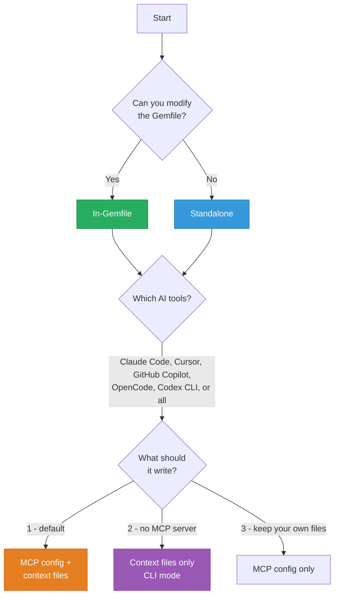

<div align="center" markdown="1">

# AI Tool Setup

**Per-editor setup for Claude Code, Cursor, Copilot, OpenCode, and Codex CLI.**

[Quickstart](QUICKSTART.md) · [Configuration](CONFIGURATION.md) · [Standalone](STANDALONE.md) · [Troubleshooting](TROUBLESHOOTING.md)

</div>

---

> [!TIP]
> Rather let your AI tool do it? Paste one of the [copy-paste prompts](PROMPTS.md) into it.

## Table of Contents

- [Which path is right for you?](#which-path-is-right-for-you)
- [Claude Code](#claude-code)
- [Cursor](#cursor)
- [GitHub Copilot](#github-copilot)
- [OpenCode](#opencode)
- [Codex CLI](#codex-cli)
- [A folder of apps](#a-folder-of-apps)
- [Ruby in Docker](#ruby-in-docker)
- [Other MCP clients](#other-mcp-clients)
- [Verify MCP is connected](#verify-mcp-is-connected)
- [HTTP Transport](#http-transport-alternative)
- [Regenerating context files](#regenerating-context-files)

---

## Which path is right for you?



## Claude Code

### Auto-setup (recommended)

```bash
rails generate rails_ai_context:install --tools claude --defaults   # or run it bare and pick "Claude Code"
rails-ai-context init --tools claude --defaults                     # standalone
```

This creates:
- `.mcp.json` - MCP config, read when a session starts in the folder; approve the server once
- `CLAUDE.md` - Root context file
- `.claude/rules/rails-schema.md` - Schema rules (loaded when editing a schema dump or a migration of any of the app's databases)
- `.claude/rules/rails-models.md` - Model rules (loaded when editing `app/models/`)
- `.claude/rules/rails-context.md` - General context rules (always loaded)
- `.claude/rules/rails-mcp-tools.md` - Tool reference: detail levels and the table of every tool (always loaded; the protocol, workflows and rules are in CLAUDE.md, so they are not loaded twice, and here only when `generate_root_files` is off)
- `.claude/rules/rails-components.md` - Component rules (loaded when editing `app/components/` or `app/views/components/`, written only when the app has view components)

Keeping your own `CLAUDE.md`? Add `--mcp-only` and only `.mcp.json` is
written; every context file is left alone. See
[CONFIGURATION.md](CONFIGURATION.md#mcp-only).

### Manual MCP config

If you need to configure manually, create `.mcp.json`:

```json
{
  "mcpServers": {
    "rails-ai-context": {
      "command": "bundle",
      "args": ["exec", "rails-ai-context", "serve"]
    }
  }
}
```

This is what the generator writes for an in-Gemfile install. A standalone install has no `bundle exec`: the command is `rails-ai-context` and the args are `["serve"]`. The same goes for the other tools below.

On Windows the command is `cmd` and `"/c"` goes ahead of the args (`["/c", "bundle", "exec", "rails-ai-context", "serve"]`): a gem's executables there are batch files, which a client that starts its server without a shell does not run. The generator writes that form on Windows, and `doctor` names an entry written for the other platform; see [GUIDE.md](GUIDE.md#mcp-server-setup) for teams on both.

### As a plugin

The repository is also a Claude Code plugin marketplace. The plugin brings the
MCP server and, at the start of each session in a Rails app, the six rules the
context files open with. It writes no context files or MCP config, so it suits
a team that keeps its own `CLAUDE.md`; the install records it in
`.claude/settings.json`.

```bash
gem install rails-ai-context      # the plugin runs the installed gem
claude plugin install rails-ai-context --marketplace crisnahine/rails-ai-context --scope project
```

In a session the second line is `/plugin install rails-ai-context --marketplace crisnahine/rails-ai-context`.
A Claude Code too old for `--marketplace` takes two steps:
`/plugin marketplace add crisnahine/rails-ai-context`, then
`/plugin install rails-ai-context@rails-ai-context`. Project scope records the
plugin in `.claude/settings.json` of the folder you run it in, so run it in the
app's folder; commit that file, and add the marketplace there too so a
teammate's Claude Code offers to install it:

```json
{
  "enabledPlugins": { "rails-ai-context@rails-ai-context": true },
  "extraKnownMarketplaces": {
    "rails-ai-context": { "source": { "source": "github", "repo": "crisnahine/rails-ai-context" } }
  }
}
```

A teammate who has the committed setting runs `claude plugin install
rails-ai-context --marketplace crisnahine/rails-ai-context --scope local`,
which leaves the committed file as it is.

- **Where it runs.** Claude Code reads `.claude/settings.json` only from the
  folder a session starts in, so project scope reaches sessions started in the
  app's folder. For sessions started in a folder inside the app, or in a
  monorepo's app folder from the repository's root, enable it with `--scope
  local` (the git repository's `settings.local.json`) or at user scope. The
  server then reads the app Claude Code was started in, the app above that
  folder, or the one app below it, as every command does. At user scope the
  plugin starts in every project; outside a Rails app its server connects with
  no tools and tells the session why. A monorepo's root whose `bin/rails`
  boots an app below it serves that app. A folder that holds several apps
  serves them all from one server (rails-ai-context 5.38.0 or later): every
  tool takes an `app` argument naming the app, the session-start rules list
  the names, and each app's own server starts at the first call that names
  it, as the `ruby` on `PATH` in that app's folder. Where rbenv's, asdf's or
  mise's shims are on `PATH`, the shim picks that Ruby by the app's own
  `.ruby-version` or `.tool-versions`, whatever folder the session started in or
  pinned: ahead of the first shims folder on `PATH`, the server leaves out
  each folder under the manager's own `versions/` or `installs/` (where its
  `exec` or `mise x` put the session's Ruby) and keeps every other folder, such
  as a system Ruby's `/usr/bin`. It also leaves out the variables that name the
  session's version. rvm,
  chruby and `mise activate` without shims pick a Ruby only through a shell
  hook, which a server's child never runs, so there every app runs the
  session's Ruby; where an app's version file names another Ruby, the first
  answer for that app says so. An app whose shim picks another Ruby than the server's gets
  none of the server's gems, so it needs the gem installed for its own Ruby.
  The server asks the shim which Ruby it runs once per app, and again at the
  app's next server start after a version file changes: the app's own or a
  parent folder's, or the manager's global one (rbenv's `version`, the home
  folder's `.tool-versions`, mise's global config). Once it has
  started, the list follows that app's own tools (its custom tools, its
  `skip_tools`, an older bundled copy's arguments, under a name ending in the
  app's) and Claude Code reads it again. An app whose server stops is started
  again at its next call, and the failed call says what it printed last.
  Resources name the app in the URI (`rails-ai-context://apps/<app>/schema`).
  Each answer's paths are relative to its app's folder, which the server's
  instructions name. An older gem serves one app, and in a folder of
  several it says to start Claude Code in one of them and names the
  `rails-ai-context --app-path <app> tool <name>` commands meanwhile. On
  macOS and Linux a local setting written at a git repository's root reaches
  every session in that repository, the apps' too. On Windows, and where the repository's root
  is your home folder or belongs to another user, a local setting reaches only
  sessions started in the folder it was written in. Where `init` at a
  repository's root wrote an app's own `.mcp.json`, which sessions started in
  the app read, a `--scope local` install that reaches those sessions runs the
  plugin beside it; `doctor` names the one to turn off.
- **The gem comes first.** The plugin needs rails-ai-context 5.36.9 or later,
  installed for the `ruby` on Claude Code's `PATH` (Ruby 3.1 or later); `gem
  update rails-ai-context` brings an older one up. A shim version manager
  (rbenv, asdf, or mise with its shims on `PATH`) picks that Ruby by the folder
  Claude Code starts in: that folder's `.ruby-version` or `.tool-versions`, or
  the global one, so a session started above the app runs that folder's Ruby. A
  shell-hook one (rvm, chruby, `mise activate`) leaves the Ruby of the shell
  that started Claude Code, and a Claude Code started from the Dock or an IDE
  may see the system Ruby instead. An app that also has the gem in its Gemfile
  gets its bundled copy, as with any standalone install, a bundle kept under
  its own path such as `vendor/bundle` too. A copy from git is the exception:
  the installed copy serves and the app's boot loads the git copy over it, so
  point the Gemfile at a release or a `path:` checkout. When the plugin cannot
  serve, its server still connects, with no tools, and tells the session why,
  naming the Ruby and the folder: no gem for that Ruby, an older one, a Ruby
  too old, a bundle Claude Code inherited from `bundle exec` that lacks the
  gem, no app or an app the gem cannot serve. The same line is the server's
  stderr, which `claude --debug` shows. From 5.38.0 the gem's own serve
  refuses the same way whatever stops it, and it keeps an app's bundled copy
  of any release behind it: a copy that stops before the handshake is
  answered by the same refusal, with what the copy printed, and one that
  stops later leaves an error naming that for each request. A start that
  fails before the plugin's script runs, such as an inherited bundle not
  installed for that Ruby (Bundler's trace,
  [TROUBLESHOOTING.md](TROUBLESHOOTING.md#mcp-server-fails-to-start)), is
  listed as failed in `/mcp`, and Claude Code then skips the server in new
  sessions for about 15 minutes: reconnect it in `/mcp` once the cause is
  fixed. A session gets no rules where the server has no tools for them to
  name, but for a folder of several apps on a gem older than 5.38.0: there
  the rules come with a last line naming the
  `rails-ai-context --app-path <app> tool <name>` commands to run instead.
- **Install the gem, not its setup, for Claude Code.** Where the app's
  `.claude/settings.json` turns the plugin on, the install generator and
  `init` write no `.mcp.json` server and say why, and so does `init` in a
  folder holding one app, where that folder's own `.claude/settings.json`
  turns it on; it still writes the app's own `.mcp.json` for sessions started
  in the app, which do not read that folder's settings, and says so. In a
  folder of several apps whose own `.claude/settings.json` turns it on,
  `init` writes no Claude Code server either, since the plugin serves each
  app there, and names the per-app servers an earlier `init` left in
  `.mcp.json`, which would list every tool twice; `--prune` removes the ones
  it wrote, and names any you wrote or added a key to, for you to remove. Where
  only your own settings turn it on, they still write one for the team, and
  their next step says to turn it off for yourself with `/mcp`.
- **The plugin or another server, not both.** Claude Code starts the plugin's
  server and one from `.mcp.json` or `claude mcp add`, an HTTP entry under the
  gem's name included, as two servers and lists every tool twice. `doctor`
  reads Claude Code the way a session does, by the folder it started in: that
  folder's settings and the local settings that reach it (its git
  repository's, a linked worktree's being its repository's, as "Where it runs"
  says), every `.mcp.json` from that folder up, the `/mcp` toggles and local
  servers Claude Code keeps for the repository, the MCP policy in
  `allowedMcpServers` and `deniedMcpServers` (by name, command or url), and a
  deployed `managed-mcp.json`, whose servers are then the only ones Claude
  Code starts, each still subject to `/mcp` and `deniedMcpServers`, and to
  `allowedMcpServers` where its entry expands a `${VAR}`, and the marketplace
  policy in `strictKnownMarketplaces` and `blockedMarketplaces`. It follows a
  `CLAUDE_CONFIG_DIR` set in your settings' `env` block, as Claude Code does.
  It does not see settings an organization delivers from the Claude console,
  through MDM or the Windows registry, and it reads the managed settings files
  as if all of them were in force; where policy comes that way, its MCP
  verdicts can be wrong. It checks the shape of `enabledPlugins` only, while
  Claude Code ignores a whole settings file that breaks its schema elsewhere
  and says so when it starts: fix such a file first. It looks at the app, the
  folder `doctor` runs in, the folders above the app that hold it alone, and
  the folders Claude Code keeps projects for. The plugin counts where it is
  enabled, installed for that project, not turned off in `/mcp` and not
  blocked by policy; then Claude Code's MCP check passes without a
  `.mcp.json`, and with no AI tools chosen it checks no other tool's config
  unless that config is broken. Where the plugin runs only for sessions
  started in another folder, `doctor` names that folder and what turns it on
  for this one. Where Claude Code never ran, as on CI, what the plugin needs
  is a warning, not a failure. Where it runs nowhere, `doctor` names why: not
  installed (with the install that leaves a committed file alone), a local
  marketplace folder that is gone, its server turned off in `/mcp`, the MCP or
  marketplace policy, a managed settings file Claude Code cannot read, or a
  `CLAUDE_CONFIG_DIR` that is empty or not an absolute path, set in the
  environment or a settings `env` block (`doctor` names which), which leaves
  each session reading its own folder's. A second server counts where such a
  session would start it, and `doctor` names the command that removes it and
  the folder to run it in: a `.mcp.json` entry comes out where the committed
  settings turn the plugin on, and is turned off with `/mcp` where only your
  own settings do.
- **The rules load once.** The hook skips them where Claude Code already loads
  the generator's rules for that session: from the app's `CLAUDE.md` or
  `.claude/rules/rails-mcp-tools.md`, or from its `AGENTS.md` where
  `CLAUDE.md` imports it or no `CLAUDE.md` is on the way up from the folder
  the session started in, or from a `CLAUDE.md`, `.claude/CLAUDE.md` or
  `CLAUDE.local.md` on that way up that carries them, as an engine's above its
  test/dummy app does (your own `~/.claude/CLAUDE.md` does not count). It
  skips them too where `.rails-ai-context.yml` or a configure block in
  `config/application.rb`, the environment's file or an initializer sets
  `anti_hallucination_rules` to `false` or `nil`; a block's value wins over
  the file's, as when the app boots. It reads that Ruby without running it, so
  only a literal that ends its statement counts, and rule 3 leaves out the
  `rails_get_config` sections `skip_tools` turns off, in the YAML or a literal
  list, assigned or appended (`=`, `<<` chained or not, `+=`, `|=`, `push`,
  `append`, `concat`); a symbol appended in place, a Set or a value built at
  boot is not read, as the server skips none of those either. A session
  started above the app gets the rules from the hook, and once a file in the
  app is read, Claude Code also loads that app's `CLAUDE.md`, so such a
  session can hold them twice. So can a session resumed after the app's
  `CLAUDE.md` gained the rules (from `init`, `context` or a pull), until
  `/clear` or a compaction.
- **Windows works the same.** The server starts `ruby` without a shell, so it
  needs no `cmd /c`.
- **One allowlist entry lasts.** The server's command line names no plugin
  folder, so no update changes it, and under an `allowedMcpServers` list this
  entry admits it (`doctor` names it where it is missing). It admits any plugin
  that ships the same line, too. Where the list admits other stdio servers by
  `serverName`, adding this entry switches every stdio server to matching by
  command, so each of them needs a `serverCommand` entry as well; `doctor`
  says so. Naming no script also keeps rbenv from picking the Ruby by the
  plugin's own folder.

  ```json
  {"serverCommand":["ruby","-e","load File.join(ENV.fetch('CLAUDE_PLUGIN_ROOT'), 'scripts', 'serve.rb')"]}
  ```
- **Permission rules name the plugin's server.** Its tools are
  `mcp__plugin_rails-ai-context_rails-ai-context__<tool>`, so a rule for the
  `.mcp.json` server (`mcp__rails-ai-context`) does not cover them;
  `mcp__plugin_rails-ai-context_rails-ai-context` allows them all.
- **A slow app's boot.** The plugin's server entry is the plugin's own, so set
  `RAILS_AI_CONTEXT_BOOT_TIMEOUT` and `MCP_TIMEOUT` in Claude Code's settings
  `env` (user, project or local) or in the shell that starts Claude Code; see
  [TROUBLESHOOTING.md](TROUBLESHOOTING.md#answers-say-boot-did-not-finish-within-20s).
- **Updates follow this repository.** The plugin's version is the commit it was
  installed from. Claude Code updates it only with auto-update on (under
  `/plugin`, Marketplaces) or `claude plugin update
  rails-ai-context@rails-ai-context`. The server is versioned by the gem: `gem
  update rails-ai-context`, then reconnect the server in `/mcp` or start a new
  session. Run `gem cleanup` only after that: a running server loads its files
  as it needs them, so once its copy is gone, a call that needs a file it has
  not loaded yet answers with a request to reconnect it.
- **Removing it** from one app is `claude plugin disable
  rails-ai-context@rails-ai-context --scope local` run there, which wins over
  your own and the committed settings for every session the local setting
  reaches ("Where it runs"). Taking an install out is `claude plugin uninstall
  rails-ai-context@rails-ai-context --scope <scope>`, with the scope it went in
  at, run in the folder it was installed from: once for a user install, once
  per project for a project or local one. A marketplace added from a local
  folder or file runs the plugin with no install, so there only the disable
  turns it off. The gem's `uninstall` leaves Claude Code's
  settings alone and names those commands, one disable per repository whose
  sessions run the plugin, before it suggests removing the gem, which the
  plugin runs; where managed settings turn the plugin on, or a deployed
  `managed-mcp.json` runs the gem, it says to ask whoever manages them.

### Split rules with `paths:` frontmatter

Claude Code loads `.claude/rules/` files conditionally based on YAML frontmatter:

```yaml
---
paths:
  - "app/models/**/*.rb"
---
```

Schema, model and component rules use this to only load when relevant files are being edited.

---

## Cursor

### Auto-setup (recommended)

```bash
rails generate rails_ai_context:install --tools cursor --defaults   # or run it bare and pick "Cursor"
rails-ai-context init --tools cursor --defaults                     # standalone
```

This creates:
- `.cursor/mcp.json` - MCP config; restart Cursor and turn the server on under MCP in Customize
- `.cursor/rules/rails-project.mdc` - Project overview (Type 1: alwaysApply)
- `.cursor/rules/rails-models.mdc` - Model rules (Type 2: glob `app/models/**/*.rb`)
- `.cursor/rules/rails-controllers.mdc` - Controller rules (Type 2: glob `app/controllers/**/*.rb`)
- `.cursor/rules/rails-mcp-tools.mdc` - Tool reference (Type 3: agent-requested)
- `.cursorrules` - **legacy single-file fallback** at the project root. Cursor's chat agent doesn't always detect `.cursor/rules/*.mdc` (reported in v5.9.0 release QA); this file is parsed verbatim by every Cursor build and contains the same compact project context `CLAUDE.md` gets in the default compact mode. It stays compact when `context_mode` is `:full`.

### Manual MCP config

Create `.cursor/mcp.json`:

```json
{
  "mcpServers": {
    "rails-ai-context": {
      "command": "bundle",
      "args": ["exec", "rails-ai-context", "serve"]
    }
  }
}
```

### Agent-requested tool loading

The MCP tools rule uses `alwaysApply: false` with a descriptive `description:` field. Cursor's agent loads it when relevant rather than on every request:

```markdown
---
description: "Rails MCP tools reference - 35 tools for schema, models, routes, controllers, search, testing, and more"
alwaysApply: false
---
```

---

## GitHub Copilot

### Auto-setup (recommended)

```bash
rails generate rails_ai_context:install --tools copilot --defaults   # or run it bare and pick "GitHub Copilot"
rails-ai-context init --tools copilot --defaults                     # standalone
```

This creates:
- `.vscode/mcp.json` - MCP config (VS Code format), started in a trusted workspace
- `.github/copilot-instructions.md` - Root instructions
- `.github/instructions/rails-models.instructions.md` - Model rules
- `.github/instructions/rails-controllers.instructions.md` - Controller rules
- `.github/instructions/rails-context.instructions.md` - Context rules
- `.github/instructions/rails-mcp-tools.instructions.md` - Tool reference: detail levels and the table of every tool (the protocol and workflows are in copilot-instructions.md, and here only when `generate_root_files` is off)

### Manual MCP config

Create `.vscode/mcp.json` (note: `servers` key, not `mcpServers`):

```json
{
  "servers": {
    "rails-ai-context": {
      "command": "bundle",
      "args": ["exec", "rails-ai-context", "serve"]
    }
  }
}
```

### Frontmatter for agent discovery

Copilot instruction files include `applyTo:`, `name:` and `description:` YAML frontmatter:

```markdown
---
applyTo: "app/models/**/*.rb"
name: "Rails Models Reference"
description: "ActiveRecord models - associations, validations, scopes, enums"
---
```

---

## OpenCode

### Auto-setup (recommended)

```bash
rails generate rails_ai_context:install --tools opencode --defaults   # or run it bare and pick "OpenCode"
rails-ai-context init --tools opencode --defaults                     # standalone
```

This creates:
- `opencode.json` - MCP config, read when OpenCode starts
- `AGENTS.md` - Root context file
- `app/models/AGENTS.md` - Model-level rules
- `app/controllers/AGENTS.md` - Controller-level rules

### Manual MCP config

Create `opencode.json`:

```json
{
  "mcp": {
    "rails-ai-context": {
      "type": "local",
      "command": ["bundle", "exec", "rails-ai-context", "serve"]
    }
  }
}
```

Note: OpenCode uses an array for the command, not a string.

---

## Codex CLI

### Auto-setup (recommended)

```bash
rails generate rails_ai_context:install --tools codex --defaults   # or run it bare and pick "Codex CLI"
rails-ai-context init --tools codex --defaults                     # standalone
```

This creates:
- `.codex/config.toml` - MCP config (TOML format) with Ruby environment snapshot. Codex reads a project's config only once you trust the project, which it asks the first time you start it there
- Shares `AGENTS.md` and OpenCode rules files

### Manual MCP config

Create `.codex/config.toml`:

```toml
[mcp_servers.rails-ai-context]
command = "bundle"
args = ["exec", "rails-ai-context", "serve"]

[mcp_servers.rails-ai-context.env]
PATH = "/Users/you/.rbenv/shims:/usr/local/bin:/usr/bin"
GEM_HOME = "/Users/you/.rbenv/versions/3.3.0/lib/ruby/gems/3.3.0"
GEM_PATH = "/Users/you/.rbenv/versions/3.3.0/lib/ruby/gems/3.3.0"
```

### Why the env section?

Codex CLI `env_clear()`s the process before spawning MCP servers. Without the env section, Ruby/Bundler can't find gems. The install generator snapshots your current Ruby environment variables automatically - works with rbenv, rvm, asdf, mise, chruby, and system Ruby.

### Checking for stale env

```bash
rails ai:doctor  # Includes check_codex_env_staleness
```

doctor fails a snapshot whose `PATH` no longer reaches the server's command (the Ruby it names was upgraded or removed; rbenv and asdf save a `PATH` and nothing else), and warns about a saved `GEM_HOME` that is gone, or a directory on a saved `GEM_PATH` that is gone and that your shell's `GEM_PATH` no longer names (RubyGems passes over a missing one, so one the shell still names is no change of Ruby). If you change Ruby versions, re-run the install generator (`rails-ai-context init` for a standalone install, in the folder of apps for a workspace's config) to update the env snapshot.

---

## A folder of apps

When your AI tool opens a folder that holds several apps (`work/shop`, `work/admin`), run `rails-ai-context init` in that folder. Each AI tool reads its MCP config from the folder it opened, so the folder's configs get one server per app, and each app keeps its own `.rails-ai-context.yml` and context files:

| AI tool | Entry for `work/shop` |
|---------|-----------------------|
| Claude Code, Codex CLI, OpenCode | `rails-ai-context serve --app-path shop`, with `RAILS_AI_CONTEXT_SERVER_NAME=shop-rails-ai-context` |
| Cursor, GitHub Copilot (VS Code) | the same, with `--app-path ${workspaceFolder}/shop` |

A monorepo's root whose `bin/rails` boots an app below it is set up the same way, as a folder holding that one app: its `.mcp.json` names the app by `--app-path`, since a session started at the root reads that file. Claude Code, Codex and OpenCode start a server in the folder they were launched in, so start them in `work/`. The [Claude Code plugin](#as-a-plugin) needs none of these entries: started in `work/`, its one server serves every app there, by the `app` each call names. Cursor and VS Code expand `${workspaceFolder}` to the folder their config sits in. An in-Gemfile app's entry runs `bundle exec` with `BUNDLE_GEMFILE` naming the Gemfile that app's bundle reads (its own, or a monorepo's shared one), spelled the same way. `RAILS_AI_CONTEXT_SERVER_NAME` makes each server announce its app first: VS Code names every tool after that name and keeps 13 characters of it. The full shape is in the [CLI reference](CLI.md#init-standalone-only), and [ADR-0005](adr/0005-workspace-mcp-entries.md) records why.

---

## HTTP Transport (alternative)

Instead of stdio, you can mount the MCP server inside your Rails app:

```ruby
# config/routes.rb
mount RailsAiContext::Engine, at: "/mcp" if defined?(RailsAiContext::Engine)
```

The `if` keeps the routes file loading wherever the gem is not: in production, where Bundler skips the `:development` group, and after the gem is removed. An unguarded mount raises `uninitialized constant RailsAiContext::Engine` there, and the app does not boot.

The mounted engine answers the server-push channel (a long-lived SSE `GET /mcp`) with 405, which the MCP spec allows a server that sends no server-initiated messages: live reload, the one thing that sends them, runs only in the standalone `rails-ai-context serve --transport http` process. Clients carry on over POST, a connected client holds a server thread only while one of its requests runs, and `rails server` stops without waiting for clients to disconnect.

The engine runs each call on the thread Rails serves the request on and sends the answer whole, so calls keep being answered while the app reloads code after an edit. What a tool sends during a call reaches the client with the answer: a custom tool's progress or log notifications arrive together at the end, and a request a tool makes of the client mid-call (sampling, elicitation, roots) fails at once with a message saying why. stdio and the standalone HTTP server (`rails-ai-context serve --transport http`) deliver both as they are sent. For the same reason the engine answers `subscriptions/listen`, whose notification stream it cannot keep open, as a method it does not have.

With a migration pending in development, Rails answers every request to the app with its pending-migration page, and the mounted engine is one of those routes: it sits behind the app's whole middleware stack, `ActiveRecord::Migration::CheckPending` included, and cannot skip it without also skipping the cookies and session an authentication constraint around the mount needs. `auto_mount` answers ahead of that check, so its tools, which report the pending migration, keep working; so do stdio and the standalone server.

Then point your AI tool's MCP config to the HTTP endpoint instead of a command. Claude Code's `.mcp.json` needs the `type` (it skips a URL entry without one):

```json
{
  "mcpServers": {
    "rails-ai-context": {
      "type": "http",
      "url": "http://localhost:3000/mcp"
    }
  }
}
```

Cursor's `.cursor/mcp.json` takes `{"url": "..."}` under `mcpServers`, VS Code's `.vscode/mcp.json` takes `{"type": "http", "url": "..."}` under `servers`, and OpenCode's `opencode.json` takes `{"type": "remote", "url": "..."}` under `mcp`. `rails-ai-context uninstall` removes such an entry under the gem's name along with the rest.

Benefits: inherits Rails routing, authentication, and middleware stack. No separate process needed.

Running the install again keeps an entry like this one, under the gem's own name, in place of the command entry it would write, and says so.

---

## Ruby in Docker

When Ruby and the gems live in a container and the AI tool runs on your machine, the server runs in the container and the MCP entry starts it through Docker. Install inside the container, then point the entry's command at it:

```json
{
  "mcpServers": {
    "rails-ai-context": {
      "command": "docker",
      "args": ["compose", "exec", "-T", "web", "bundle", "exec", "rails-ai-context", "serve"]
    }
  }
}
```

With a plain container the args are `["exec", "-i", "CONTAINER", "bundle", "exec", "rails-ai-context", "serve"]`. Keep `-T` (Compose) or `-i` (plain Docker) and never add `-t`: a terminal mangles the MCP messages. The container must be running before the AI tool starts. The install and every context run keep an entry whose command the gem did not write as it is, and say so; delete the entry and run the install again to go back to `bundle exec`. The [Ruby runs in Docker](PROMPTS.md#ruby-runs-in-docker) prompt walks an AI tool through all of it. When the AI tool runs inside the container too (a devcontainer), nothing changes: use the usual install.

---

## Other MCP clients

Claude Desktop, Windsurf, Zed, JetBrains IDEs and other clients get no config file from the install, and they start servers from their own folder with their own `PATH`. `rails-ai-context mcp-entry` prints an entry that works from anywhere: the real Ruby binary by its full path (past any version manager's shim, which would choose a Ruby by the client's folder), the gem's executable, `--app-path` naming the app, and the gem environment it needs:

```bash
rails-ai-context mcp-entry               # standalone install
bundle exec rails-ai-context mcp-entry   # in the Gemfile
```

Merge the printed `rails-ai-context` entry into the client's config under the key it uses for servers (`mcpServers` for most; Claude Desktop keeps it in `claude_desktop_config.json`). Run it again after the app moves or its Ruby changes. The [Another MCP client](PROMPTS.md#another-mcp-client) prompt does this for you.

---

## Verify MCP is connected

Each AI tool holds a project's MCP server back until you take one step in the tool. The install's closing summary names it for every tool you picked, under "Next step". Then check the server is up:

| AI tool | Step after the install | Check it is connected |
|:--------|:-----------------------|:----------------------|
| Claude Code | Start a new `claude` session in the app's folder and approve `rails-ai-context` when it asks. To be asked again about a server you declined: `claude mcp reset-project-choices` | `/mcp` in the session, or `claude mcp list` |
| Cursor | Restart Cursor, then turn `rails-ai-context` on under MCP in Customize if it is off. Cursor asks before each tool call unless you allow it | Output panel (Cmd+Shift+U), "MCP Logs" |
| GitHub Copilot (VS Code) | Open the folder as a trusted workspace: a restricted one starts no workspace MCP server. VS Code starts the server when you send a Copilot Chat message | Command Palette, "MCP: List Servers", then the server's "Show Output" |
| OpenCode | Restart OpenCode in the app's folder | `opencode mcp list` |
| Codex CLI | Trust the project when Codex asks: Codex skips the `.codex/config.toml` of a project you have not trusted, and warns that it did. Then start a new `codex` session | `/mcp` in the session, or `codex mcp list` |

Then ask the assistant something only the app knows, such as "What columns does the users table have?", and watch for a `rails_get_schema` call.

### If the tools still don't appear

```bash
rails ai:doctor   # in-Gemfile: checks every MCP config and whether its command can start
rails-ai-context doctor   # standalone
bundle exec rails-ai-context serve   # should start and wait on stdin (Ctrl+C to stop); drop bundle exec when standalone
```

---

## Regenerating context files

After configuration changes:

```bash
rails ai:context         # Regenerate for all configured tools
rails ai:context:claude  # Regenerate for Claude only
rails ai:context:cursor  # Regenerate for Cursor only
```

Or use watch mode for automatic regeneration:

```bash
rails ai:watch
```

---

<div align="center" markdown="1">

**[← Configuration](CONFIGURATION.md)** · **[Architecture →](ARCHITECTURE.md)**

[Back to Home](index.md)

</div>
