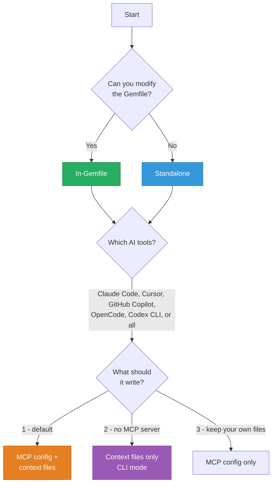

<div align="center" markdown="1">

# AI Tool Setup

**Per-editor setup for Claude Code, Cursor, Copilot, OpenCode, and Codex CLI.**

[Quickstart](QUICKSTART.md) · [Configuration](CONFIGURATION.md) · [Standalone](STANDALONE.md) · [Troubleshooting](TROUBLESHOOTING.md)

</div>

---

> [!TIP]
> Rather let your AI tool do it? Paste one of the [copy-paste prompts](PROMPTS.md) into it.

## Table of Contents

- [Which path is right for you?](#which-path-is-right-for-you)
- [Claude Code](#claude-code)
- [Cursor](#cursor)
- [GitHub Copilot](#github-copilot)
- [OpenCode](#opencode)
- [Codex CLI](#codex-cli)
- [A folder of apps](#a-folder-of-apps)
- [Ruby in Docker](#ruby-in-docker)
- [Other MCP clients](#other-mcp-clients)
- [Verify MCP is connected](#verify-mcp-is-connected)
- [HTTP Transport](#http-transport-alternative)
- [Regenerating context files](#regenerating-context-files)

---

## Which path is right for you?



## Claude Code

### Auto-setup (recommended)

```bash
rails generate rails_ai_context:install --tools claude --defaults   # or run it bare and pick "Claude Code"
rails-ai-context init --tools claude --defaults                     # standalone
```

This creates:
- `.mcp.json` - MCP config, read when a session starts in the folder; approve the server once
- `CLAUDE.md` - Root context file
- `.claude/rules/rails-schema.md` - Schema rules (loaded when editing a schema dump or a migration of any of the app's databases)
- `.claude/rules/rails-models.md` - Model rules (loaded when editing `app/models/`)
- `.claude/rules/rails-context.md` - General context rules (always loaded)
- `.claude/rules/rails-mcp-tools.md` - Tool reference: detail levels and the table of every tool (always loaded; the protocol, workflows and rules are in CLAUDE.md, so they are not loaded twice, and here only when `generate_root_files` is off)
- `.claude/rules/rails-components.md` - Component rules (loaded when editing `app/components/` or `app/views/components/`, written only when the app has view components)

Keeping your own `CLAUDE.md`? Add `--mcp-only` and only `.mcp.json` is
written; every context file is left alone. See
[CONFIGURATION.md](CONFIGURATION.md#mcp-only).

### Manual MCP config

If you need to configure manually, create `.mcp.json`:

```json
{
  "mcpServers": {
    "rails-ai-context": {
      "command": "bundle",
      "args": ["exec", "rails-ai-context", "serve"]
    }
  }
}
```

This is what the generator writes for an in-Gemfile install. A standalone install has no `bundle exec`: the command is `rails-ai-context` and the args are `["serve"]`. The same goes for the other tools below.

On Windows the command is `cmd` and `"/c"` goes ahead of the args (`["/c", "bundle", "exec", "rails-ai-context", "serve"]`): a gem's executables there are batch files, which a client that starts its server without a shell does not run. The generator writes that form on Windows, and `doctor` names an entry written for the other platform; see [GUIDE.md](GUIDE.md#mcp-server-setup) for teams on both.

### Split rules with `paths:` frontmatter

Claude Code loads `.claude/rules/` files conditionally based on YAML frontmatter:

```yaml
---
paths:
  - "app/models/**/*.rb"
---
```

Schema, model and component rules use this to only load when relevant files are being edited.

---

## Cursor

### Auto-setup (recommended)

```bash
rails generate rails_ai_context:install --tools cursor --defaults   # or run it bare and pick "Cursor"
rails-ai-context init --tools cursor --defaults                     # standalone
```

This creates:
- `.cursor/mcp.json` - MCP config; restart Cursor and turn the server on under MCP in Customize
- `.cursor/rules/rails-project.mdc` - Project overview (Type 1: alwaysApply)
- `.cursor/rules/rails-models.mdc` - Model rules (Type 2: glob `app/models/**/*.rb`)
- `.cursor/rules/rails-controllers.mdc` - Controller rules (Type 2: glob `app/controllers/**/*.rb`)
- `.cursor/rules/rails-mcp-tools.mdc` - Tool reference (Type 3: agent-requested)
- `.cursorrules` - **legacy single-file fallback** at the project root. Cursor's chat agent doesn't always detect `.cursor/rules/*.mdc` (reported in v5.9.0 release QA); this file is parsed verbatim by every Cursor build and contains the same compact project context `CLAUDE.md` gets in the default compact mode. It stays compact when `context_mode` is `:full`.

### Manual MCP config

Create `.cursor/mcp.json`:

```json
{
  "mcpServers": {
    "rails-ai-context": {
      "command": "bundle",
      "args": ["exec", "rails-ai-context", "serve"]
    }
  }
}
```

### Agent-requested tool loading

The MCP tools rule uses `alwaysApply: false` with a descriptive `description:` field. Cursor's agent loads it when relevant rather than on every request:

```markdown
---
description: "Rails MCP tools reference - 35 tools for schema, models, routes, controllers, search, testing, and more"
alwaysApply: false
---
```

---

## GitHub Copilot

### Auto-setup (recommended)

```bash
rails generate rails_ai_context:install --tools copilot --defaults   # or run it bare and pick "GitHub Copilot"
rails-ai-context init --tools copilot --defaults                     # standalone
```

This creates:
- `.vscode/mcp.json` - MCP config (VS Code format), started in a trusted workspace
- `.github/copilot-instructions.md` - Root instructions
- `.github/instructions/rails-models.instructions.md` - Model rules
- `.github/instructions/rails-controllers.instructions.md` - Controller rules
- `.github/instructions/rails-context.instructions.md` - Context rules
- `.github/instructions/rails-mcp-tools.instructions.md` - Tool reference: detail levels and the table of every tool (the protocol and workflows are in copilot-instructions.md, and here only when `generate_root_files` is off)

### Manual MCP config

Create `.vscode/mcp.json` (note: `servers` key, not `mcpServers`):

```json
{
  "servers": {
    "rails-ai-context": {
      "command": "bundle",
      "args": ["exec", "rails-ai-context", "serve"]
    }
  }
}
```

### Frontmatter for agent discovery

Copilot instruction files include `applyTo:`, `name:` and `description:` YAML frontmatter:

```markdown
---
applyTo: "app/models/**/*.rb"
name: "Rails Models Reference"
description: "ActiveRecord models - associations, validations, scopes, enums"
---
```

---

## OpenCode

### Auto-setup (recommended)

```bash
rails generate rails_ai_context:install --tools opencode --defaults   # or run it bare and pick "OpenCode"
rails-ai-context init --tools opencode --defaults                     # standalone
```

This creates:
- `opencode.json` - MCP config, read when OpenCode starts
- `AGENTS.md` - Root context file
- `app/models/AGENTS.md` - Model-level rules
- `app/controllers/AGENTS.md` - Controller-level rules

### Manual MCP config

Create `opencode.json`:

```json
{
  "mcp": {
    "rails-ai-context": {
      "type": "local",
      "command": ["bundle", "exec", "rails-ai-context", "serve"]
    }
  }
}
```

Note: OpenCode uses an array for the command, not a string.

---

## Codex CLI

### Auto-setup (recommended)

```bash
rails generate rails_ai_context:install --tools codex --defaults   # or run it bare and pick "Codex CLI"
rails-ai-context init --tools codex --defaults                     # standalone
```

This creates:
- `.codex/config.toml` - MCP config (TOML format) with Ruby environment snapshot. Codex reads a project's config only once you trust the project, which it asks the first time you start it there
- Shares `AGENTS.md` and OpenCode rules files

### Manual MCP config

Create `.codex/config.toml`:

```toml
[mcp_servers.rails-ai-context]
command = "bundle"
args = ["exec", "rails-ai-context", "serve"]

[mcp_servers.rails-ai-context.env]
PATH = "/Users/you/.rbenv/shims:/usr/local/bin:/usr/bin"
GEM_HOME = "/Users/you/.rbenv/versions/3.3.0/lib/ruby/gems/3.3.0"
GEM_PATH = "/Users/you/.rbenv/versions/3.3.0/lib/ruby/gems/3.3.0"
```

### Why the env section?

Codex CLI `env_clear()`s the process before spawning MCP servers. Without the env section, Ruby/Bundler can't find gems. The install generator snapshots your current Ruby environment variables automatically - works with rbenv, rvm, asdf, mise, chruby, and system Ruby.

### Checking for stale env

```bash
rails ai:doctor  # Includes check_codex_env_staleness
```

doctor fails a snapshot whose `PATH` no longer reaches the server's command (the Ruby it names was upgraded or removed; rbenv and asdf save a `PATH` and nothing else), and warns about a saved `GEM_HOME` that is gone, or a directory on a saved `GEM_PATH` that is gone and that your shell's `GEM_PATH` no longer names (RubyGems passes over a missing one, so one the shell still names is no change of Ruby). If you change Ruby versions, re-run the install generator (`rails-ai-context init` for a standalone install, in the folder of apps for a workspace's config) to update the env snapshot.

---

## A folder of apps

When your AI tool opens a folder that holds several apps (`work/shop`, `work/admin`), run `rails-ai-context init` in that folder. Each AI tool reads its MCP config from the folder it opened, so the folder's configs get one server per app, and each app keeps its own `.rails-ai-context.yml` and context files:

| AI tool | Entry for `work/shop` |
|---------|-----------------------|
| Claude Code, Codex CLI, OpenCode | `rails-ai-context serve --app-path shop`, with `RAILS_AI_CONTEXT_SERVER_NAME=shop-rails-ai-context` |
| Cursor, GitHub Copilot (VS Code) | the same, with `--app-path ${workspaceFolder}/shop` |

Claude Code, Codex and OpenCode start a server in the folder they were launched in, so start them in `work/`. Cursor and VS Code expand `${workspaceFolder}` to the folder their config sits in. An in-Gemfile app's entry runs `bundle exec` with `BUNDLE_GEMFILE` naming the Gemfile that app's bundle reads (its own, or a monorepo's shared one), spelled the same way. `RAILS_AI_CONTEXT_SERVER_NAME` makes each server announce its app first: VS Code names every tool after that name and keeps 13 characters of it. The full shape is in the [CLI reference](CLI.md#init-standalone-only), and [ADR-0005](adr/0005-workspace-mcp-entries.md) records why.

---

## HTTP Transport (alternative)

Instead of stdio, you can mount the MCP server inside your Rails app:

```ruby
# config/routes.rb
mount RailsAiContext::Engine, at: "/mcp" if defined?(RailsAiContext::Engine)
```

The `if` keeps the routes file loading wherever the gem is not: in production, where Bundler skips the `:development` group, and after the gem is removed. An unguarded mount raises `uninitialized constant RailsAiContext::Engine` there, and the app does not boot.

The mounted engine answers the server-push channel (a long-lived SSE `GET /mcp`) with 405, which the MCP spec allows a server that sends no server-initiated messages: live reload, the one thing that sends them, runs only in the standalone `rails-ai-context serve --transport http` process. Clients carry on over POST, a connected client holds a server thread only while one of its requests runs, and `rails server` stops without waiting for clients to disconnect.

The engine runs each call on the thread Rails serves the request on and sends the answer whole, so calls keep being answered while the app reloads code after an edit. What a tool sends during a call reaches the client with the answer: a custom tool's progress or log notifications arrive together at the end, and a request a tool makes of the client mid-call (sampling, elicitation, roots) fails at once with a message saying why. stdio and the standalone HTTP server (`rails-ai-context serve --transport http`) deliver both as they are sent. For the same reason the engine answers `subscriptions/listen`, whose notification stream it cannot keep open, as a method it does not have.

With a migration pending in development, Rails answers every request to the app with its pending-migration page, and the mounted engine is one of those routes: it sits behind the app's whole middleware stack, `ActiveRecord::Migration::CheckPending` included, and cannot skip it without also skipping the cookies and session an authentication constraint around the mount needs. `auto_mount` answers ahead of that check, so its tools, which report the pending migration, keep working; so do stdio and the standalone server.

Then point your AI tool's MCP config to the HTTP endpoint instead of a command. Claude Code's `.mcp.json` needs the `type` (it skips a URL entry without one):

```json
{
  "mcpServers": {
    "rails-ai-context": {
      "type": "http",
      "url": "http://localhost:3000/mcp"
    }
  }
}
```

Cursor's `.cursor/mcp.json` takes `{"url": "..."}` under `mcpServers`, VS Code's `.vscode/mcp.json` takes `{"type": "http", "url": "..."}` under `servers`, and OpenCode's `opencode.json` takes `{"type": "remote", "url": "..."}` under `mcp`. `rails-ai-context uninstall` removes such an entry under the gem's name along with the rest.

Benefits: inherits Rails routing, authentication, and middleware stack. No separate process needed.

Running the install again keeps an entry like this one, under the gem's own name, in place of the command entry it would write, and says so.

---

## Ruby in Docker

When Ruby and the gems live in a container and the AI tool runs on your machine, the server runs in the container and the MCP entry starts it through Docker. Install inside the container, then point the entry's command at it:

```json
{
  "mcpServers": {
    "rails-ai-context": {
      "command": "docker",
      "args": ["compose", "exec", "-T", "web", "bundle", "exec", "rails-ai-context", "serve"]
    }
  }
}
```

With a plain container the args are `["exec", "-i", "CONTAINER", "bundle", "exec", "rails-ai-context", "serve"]`. Keep `-T` (Compose) or `-i` (plain Docker) and never add `-t`: a terminal mangles the MCP messages. The container must be running before the AI tool starts, and running the install again rewrites the entry back to `bundle exec`. The [Ruby runs in Docker](PROMPTS.md#ruby-runs-in-docker) prompt walks an AI tool through all of it. When the AI tool runs inside the container too (a devcontainer), nothing changes: use the usual install.

---

## Other MCP clients

Claude Desktop, Windsurf, Zed, JetBrains IDEs and other clients get no config file from the install, and they start servers from their own folder with their own `PATH`. `rails-ai-context mcp-entry` prints an entry that works from anywhere: the real Ruby binary by its full path (past any version manager's shim, which would choose a Ruby by the client's folder), the gem's executable, `--app-path` naming the app, and the gem environment it needs:

```bash
rails-ai-context mcp-entry               # standalone install
bundle exec rails-ai-context mcp-entry   # in the Gemfile
```

Merge the printed `rails-ai-context` entry into the client's config under the key it uses for servers (`mcpServers` for most; Claude Desktop keeps it in `claude_desktop_config.json`). Run it again after the app moves or its Ruby changes. The [Another MCP client](PROMPTS.md#another-mcp-client) prompt does this for you.

---

## Verify MCP is connected

Each AI tool holds a project's MCP server back until you take one step in the tool. The install's closing summary names it for every tool you picked, under "Next step". Then check the server is up:

| AI tool | Step after the install | Check it is connected |
|:--------|:-----------------------|:----------------------|
| Claude Code | Start a new `claude` session in the app's folder and approve `rails-ai-context` when it asks. To be asked again about a server you declined: `claude mcp reset-project-choices` | `/mcp` in the session, or `claude mcp list` |
| Cursor | Restart Cursor, then turn `rails-ai-context` on under MCP in Customize if it is off. Cursor asks before each tool call unless you allow it | Output panel (Cmd+Shift+U), "MCP Logs" |
| GitHub Copilot (VS Code) | Open the folder as a trusted workspace: a restricted one starts no workspace MCP server. VS Code starts the server when you send a Copilot Chat message | Command Palette, "MCP: List Servers", then the server's "Show Output" |
| OpenCode | Restart OpenCode in the app's folder | `opencode mcp list` |
| Codex CLI | Trust the project when Codex asks: Codex skips the `.codex/config.toml` of a project you have not trusted, and warns that it did. Then start a new `codex` session | `/mcp` in the session, or `codex mcp list` |

Then ask the assistant something only the app knows, such as "What columns does the users table have?", and watch for a `rails_get_schema` call.

### If the tools still don't appear

```bash
rails ai:doctor   # in-Gemfile: checks every MCP config and whether its command can start
rails-ai-context doctor   # standalone
bundle exec rails-ai-context serve   # should start and wait on stdin (Ctrl+C to stop); drop bundle exec when standalone
```

---

## Regenerating context files

After configuration changes:

```bash
rails ai:context         # Regenerate for all configured tools
rails ai:context:claude  # Regenerate for Claude only
rails ai:context:cursor  # Regenerate for Cursor only
```

Or use watch mode for automatic regeneration:

```bash
rails ai:watch
```

---

<div align="center" markdown="1">

**[← Configuration](CONFIGURATION.md)** · **[Architecture →](ARCHITECTURE.md)**

[Back to Home](index.md)

</div>
